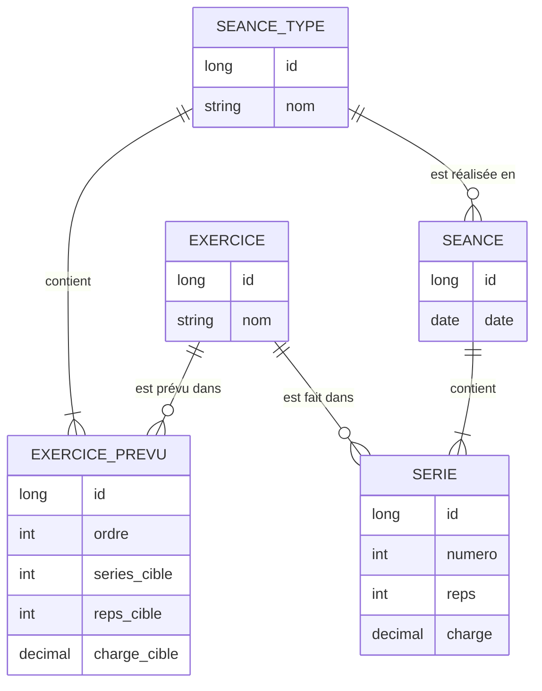

# Backlog produit

## Vision
Remplacer mes notes de téléphone par une application qui me permet d'enregistrer mes séances et de **voir ma progression semaine après semaine, pour ne pas lâcher**.

## Besoins recensés
| # | Besoin | Dépend de | Statut |
|---|---|---|---|
| 1 | Saisir mon programme (ce que je prévois de faire) | — | À prioriser |
| 2 | Enregistrer ce que j'ai réellement fait (exercice, séries, reps, charge), **rapidement, entre deux séries** | — | À prioriser |
| 3 | Voir ma progression sur un exercice dans le temps | 2 | À prioriser |
| 4 | Mesurer ma régularité (% séances faites / prévues) | 1, 2 | À prioriser |
| 5 | Bilan mensuel (stats agrégées) | 2 | À prioriser |
| 6 | Suivre mes mesures corporelles (données de balance, saisie mensuelle) | — (indépendant) | À prioriser |
| 7 | Notifications | — | Hors périmètre de la semaine |
| — | Authentification / comptes utilisateurs | — | Candidate Sprint 2 |

## Sprint 1
**Périmètre** : besoin 2 (enregistrer le réalisé). Le programme (besoin 1) est chargé en base par un script de seed, sans écran de saisie.

### US-01 – Saisir une séance réalisée
*En tant que sportif, je veux enregistrer pendant ma séance les séries que je réalise afin de ne pas oublier ce que j'ai fait d'une séance à l'autre.*

Critères d'acceptation :
- Je peux démarrer une séance en choisissant une séance type de mon programme (ex. Pull #1) dans une liste.
- La séance est datée du jour par défaut, et je peux modifier la date.
- Les exercices de la séance type me sont proposés.
- Pour chaque exercice, j'ajoute autant de séries que nécessaire, chacune avec ses répétitions et sa charge. La charge peut varier d'une série à l'autre.
- Une série s'ajoute sans quitter l'écran de la séance.
- Après enregistrement, je retrouve la séance et son détail dans la liste de mes séances.

## Modèle de données (Sprint 1)

- **Programme (le prévu)** : `SEANCE_TYPE` + `EXERCICE_PREVU`, non daté, chargé par seed.
- **Réalisé** : `SEANCE` (datée, pointe vers sa séance type) + `SERIE` (une ligne par série réellement faite).
- Les métriques (volume, charge max…) seront calculées à partir de `SERIE`, jamais stockées.